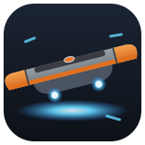
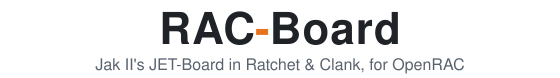
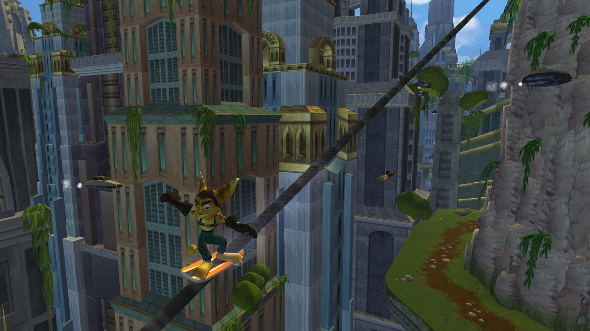
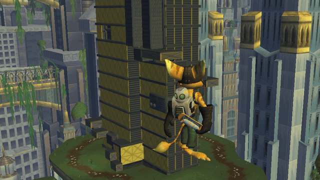

<h1 align="center">
  <br>
  <picture>
    <source media="(prefers-color-scheme: dark)" srcset="docs/readme/title-dark.svg">
    
  </picture>
</h1>

<br>

<p align="center">
  <strong>Jak II's JET-Board in Ratchet &amp; Clank.</strong><br>
  Jak II's own board code, ported from OpenGOAL, running in OpenRAC's native port.
</p>

<p align="center">
  <a href="https://github.com/mateuszklysz/rac-board/releases/latest"></a>
  <a href="https://github.com/mateuszklysz/rac-board/actions/workflows/build.yml"></a>
  <a href="https://github.com/OpenRAC/OpenRAC"></a>
  <a href="LICENSE"></a>
</p>

<p align="center">
  <a href="#install">Install</a> ·
  <a href="#controls">Controls</a> ·
  <a href="#build">Build</a> ·
  <a href="docs/how-it-works.md">How it works</a> ·
  <a href="docs/jak2-parity.md">Jak II parity</a>
</p>

<p align="center">
  
</p>

## What is it?

A mod that gives Ratchet Jak II's JET-Board.

- **Jak II's real board logic.** The states, physics, tricks and collision are Jak II's code, ported line by line.
- **Its quirks too.** Hovers, extended flips and the other speedrun glitches work as in Jak II.
- **Grind any rail.** Every grind rail in the game can be ridden, plus any edge Jak could grind.
- **Tricks and combos.** Spins, flips, grabs, boosts, with Jak II's names and points on screen.
- **Ratchet's own style.** He rides in clips made for him, with Clank on his back.
- **Nothing from the discs.** The board model, sounds and effects are made by this repo's tools.

<p align="center">
  
</p>

## Install

1. Get [OpenRAC](https://github.com/OpenRAC/OpenRAC) with mod interface 1.12 or newer.
2. In the launcher, open the **Mods** tab.
3. Paste `https://github.com/mateuszklysz/rac-board` and install.
4. Play Ratchet & Clank (PAL or NTSC-U) and press **D-pad Up** to get on.

## Controls

The board takes these buttons only while Ratchet rides. On foot the game's controls are unchanged.

| Action | Pad | Jak II |
|---|---|---|
| Get on and off | D-pad Up (or D-pad Down, L2+R2, or R2) | R2 |
| Jump (hold for higher) | Cross | Cross |
| Spin (stick left or right), flip (stick up or down) | R1 or R2 | R1 |
| Grind a rail | Hold R1 or R2 with Cross | Circle or Square |
| Duck, duck jump, grabs in the air | L1 | L1 |

- Circle, Square and Triangle keep the game's jobs.
- In a trick a faint ring under Ratchet points where the board's nose is (the light orange pointer), and a dot shows where he is going: land with the two together for the boost. Within 40 degrees counts, and the board eases straight as it lands.
- The spin, grind and duck buttons can be changed in the mod's settings (Jak II's layout too).
- **Board camera** (off by default) is Jak II's camera. The right stick swings it round.
- On a keyboard, **B** gets on and off (you can rebind it).

## Build

```sh
python3 tools/fetch_sdk.py        # the OpenRAC SDK that sdk.lock pins, into .sdk/
cmake -S . -B build -G Ninja
cmake --build build
ctest --test-dir build
```

To build against an OpenRAC checkout instead, pass `-DOPENRAC_SDK=<checkout>/sdk`.

Push a tag `v<version>` and the build workflow publishes a release the launcher can install.

## Docs

| Page | What |
|---|---|
| [How it works](docs/how-it-works.md) | The frame, the folders, the rails |
| [Jak II parity](docs/jak2-parity.md) | What is the same as Jak II, what changed, what is missing |
| [Glitches](docs/glitches.md) | The board glitches the mod keeps |
| [Contributing](CONTRIBUTING.md) | Commit rules |

## Credits

- [OpenGOAL](https://github.com/open-goal/jak-project) for the decompiled Jak II code the board is ported from.
- [OpenRAC](https://github.com/OpenRAC/OpenRAC) for the native Ratchet & Clank and its mod interface.

## Licence

MIT ([LICENSE](LICENSE)). Files ported from OpenGOAL are also under OpenGOAL's ISC licence ([THIRD_PARTY.md](THIRD_PARTY.md)).
